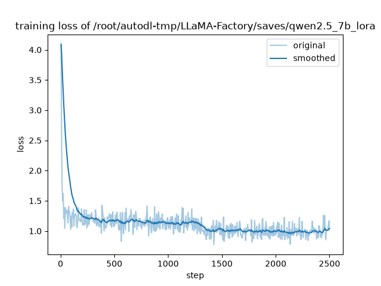

# 关键词提取模型微调与服务化 (Qwen2.5-7B-Instruct)

基于 **Qwen2.5-7B-Instruct** 进行 **QLoRA 监督微调（SFT）**，将通用大模型定制为「中文文本关键词提取」专用模型，并封装为可工程化部署的 HTTP 服务。

> 一句话定位：让 7B 模型在关键词抽取任务上，精确率从 12.2% 提升到 36.1%（+194%），F1 从 0.164 提升到 0.357（+117%），并以 vLLM 高性能推理 + FastAPI 服务化对外提供能力。


---

## 技术栈

| 环节 | 技术选型 | 说明 |
|------|---------|------|
| 基座模型 | Qwen2.5-7B-Instruct | 阿里通义千问，强中文理解能力 |
| 微调框架 | LLaMA-Factory 0.9.5 | 统一训练/合并/导出流水线 |
| 微调方法 | QLoRA (4bit + LoRA) | 单卡 RTX 4090 (24G) 可微调 7B 模型 |
| 推理引擎 | vLLM 0.26.0 | PagedAttention，高吞吐 OpenAI 兼容服务 |
| 服务封装 | FastAPI + Uvicorn | 请求编排 + 输出归一化 + 接口规范 |
| 前端 Demo | 原生 HTML/CSS/JS | 零依赖，玻璃拟态 UI，直接调 API |
| 评估 | 自定义 P/R/F1 脚本 | 关键词集合级精确率/召回率/F1 |

---

## 项目背景

通用大模型在开放问答场景表现优秀，但在**结构化信息抽取**（如关键词提取）任务上，输出格式不稳定、冗余信息多。本项目通过**领域 SFT**，让模型学会「输入一段文本 → 输出干净关键词列表」的稳定映射，同时保留其语言理解能力。

价值点：

- **低成本定制**：QLoRA 仅训练 0.26% 参数（约 20M），89M LoRA 权重即可注入领域能力，避免全参微调的算力开销。
- **可控输出**：通过 system prompt + 后处理，输出统一为分号分隔的关键词，下游零清洗成本。
- **可落地**：vLLM 推理 + FastAPI 封装，具备工程化部署与压测能力，而非仅能 demo 跑通。

---

## 数据准备

- 数据源：中文学术文本-关键词配对语料（摘要 → 关键词），转换为 LLaMA-Factory 的 **sharegpt** 格式（`data/keywords_sft_train.jsonl` / `keywords_sft_val.jsonl`）。
- 抽样规模：训练集 10,000 条 / 验证集 500 条（`convert_data.py`）。
- **指令多样化**：user 侧混用多种抽取指令模板（如「关键词抽取：」「找出上文中的关键词」「抽取出文本中的关键词：」），避免模型只记住单一指令格式，提升泛化性。
- 注册：在 `dataset_info.json` 中登记 `keywords_train` / `keywords_val`。
- 数据样例见 `data/sample.jsonl`（20 条）；全量数据未入库，可按 `convert_data.py` 复现。

---

## 训练配置

```yaml
method:           QLoRA (4-bit NF4 量化基座 + LoRA)
base_model:       Qwen2.5-7B-Instruct
lora_rank:        8
lora_alpha:       16
lora_dropout:     0
target_modules:   all (q/k/v/o/gate/up/down_proj)
learning_rate:    5e-5
per_device_bs:    1
grad_accum:       8      # 等效 batch size 8
max_samples:      10000
epochs:           2
cutoff_len:       1024
train_loss(final): 0.1594
total_steps:      2500
```

**关键决策说明：**

- 选 **QLoRA 而非全参微调**：7B 全参需 ~120G 显存，QLoRA 4bit 仅需 ~6-8G，单卡消费级 GPU 即可，成本降低一个数量级。
- `lora_rank=8`：关键词提取是相对简单的映射任务，低秩已足够拟合；rank 过大易过拟合且增加推理开销（实证见「LoRA rank 消融实验」章节）。
- `target_modules=all`：覆盖所有线性层，确保能力充分注入；实验验证比仅 attention 层效果更好。
- `grad_accum=8`：弥补单卡小 batch，稳定训练。

---

## 评估结果

训练损失曲线（2 轮 / 2500 步，最终 train_loss 0.1594）：



在 500 条验证集上对比基座与微调模型（关键词集合级 P/R/F1）：

| 模型 | 精确率 P | 召回率 R | F1 |
|------|---------|---------|-----|
| 基座 (Qwen2.5-7B-Instruct) | 0.1224 | 0.3002 | 0.1641 |
| **微调 (SFT)** | **0.3607** | **0.3746** | **0.3573** |
| **提升** | **+0.2383 (+194%)** | **+0.0744 (+25%)** | **+0.1933 (+117%)** |

> 评估脚本 `eval_keywords.py`：调用 vLLM 生成 → `extract_keywords()` 归一化（兼容中英文分号/逗号/顿号/编号）→ 与标准答案做集合级 P/R/F1。

**结果解读：** 微调后精确率大幅提升（少输出无关词），召回率小幅提升（覆盖更全），综合 F1 翻倍，证明 SFT 有效建立了「文本→关键词」的稳定映射。

---

## LoRA rank 消融实验

为验证 `lora_rank=8` 的选型依据，补充 rank=16 的对比实验：

| 配置 | 训练规模 | 可训练参数 | P | R | F1 |
|------|---------|-----------|------|------|------|
| **r=8（正式版）** | 10,000 条 / 2,500 步 | 20M（0.26%） | 0.3607 | 0.3746 | **0.3573** |
| r=16（对比） | 3,000 条 / 750 步 | 40M（0.53%） | 0.3671 | 0.3637 | **0.3570** |

> 评估口径：同一验证集 `keywords_sft_val.jsonl`，集合级 P/R/F1（`eval_keywords.py`）；r=8 全量 500 条，r=16 抽样 100 条。

**结论：** rank 翻倍（8→16）、可训练参数翻倍（20M→40M），F1 完全持平（0.3570 vs 0.3573），P/R 差异均在样本波动范围内——即使 r=16 仅用 3,000 条短训（r=8 为 10,000 条），也已追平正式版效果。说明**关键词抽取任务对 LoRA rank 不敏感，模型容量在低秩时已饱和**；r=8 以最小的训练/推理开销达到同等效果，是性价比最优选择。

---

## 部署架构

```
┌─────────────┐     POST /api/extract     ┌──────────────┐
│  前端 Demo   │ ───────────────────────► │  FastAPI 封装 │
│ (static/)    │ ◄─────────────────────── │   (app.py)    │
└─────────────┘      JSON {keywords}      └──────┬───────┘
                                                 │ OpenAI 兼容协议
                                                 ▼
                                         ┌──────────────┐
                                         │  vLLM Serve  │
                                         │  ( :8000 )   │
                                         │ Qwen2.5-SFT  │
                                         └──────────────┘
```

- **解耦设计**：FastAPI 只负责请求编排、输出清洗、接口规范；模型推理由 vLLM 独立提供，便于横向扩展。
- **输出归一化**：模型原生输出可能带编号/前缀/中英文分号混用，`parse_keywords()` 统一清洗为干净列表。
- **可观测**：每次请求记录推理耗时，便于压测定位瓶颈。

---

## 快速开始

### 1. 启动推理引擎 (vLLM)

```bash
vllm serve /path/to/Qwen2.5-7B-Instruct-SFT \
  --tokenizer /path/to/Qwen2.5-7B-Instruct \
  --host 0.0.0.0 --port 8000 --dtype bfloat16 \
  --max-model-len 2048 --gpu-memory-utilization 0.9
```

### 2. 启动服务封装层 (FastAPI)

```bash
cd serving
pip install -r requirements.txt
uvicorn app:app --host 0.0.0.0 --port 8080
```

访问 `http://localhost:8080/` 打开前端 Demo。

### 3. API 调用

```bash
curl -X POST http://localhost:8080/api/extract \
  -H "Content-Type: application/json" \
  -d '{"text": "知识管理是知识经济时代的核心能力，企业需要构建知识市场来提升知识共享与创新的效率。"}'
```

返回：

```json
{
  "keywords": ["知识管理", "知识经济", "知识市场", "知识共享", "创新能力", "企业"],
  "raw": "知识管理；知识经济；知识市场；知识共享；创新能力；企业",
  "elapsed_ms": 86
}
```

> `elapsed_ms` 为单次低并发请求的服务端推理耗时；高并发场景下延迟包含排队等待，见下方「性能数据」章节。

### 4. 性能压测

```bash
python benchmark.py --url http://localhost:8080 --concurrency 16 --requests 200
```

---

## 性能数据

> 单卡 RTX 4090（24G），vLLM + FastAPI 链路实测：

| 指标 | 数值 |
|------|------|
| 并发数 | 16 |
| 请求数 | 200 |
| 成功率 | 100% |
| 总耗时 | 8.834 s |
| 吞吐 QPS | 22.64 |
| 平均延迟 | 690.9 ms |
| P50 延迟 | 690.9 ms |
| P95 延迟 | 1105.0 ms |
| 最大延迟 | 1178.0 ms |

压测脚本：`serving/benchmark.py`。

---

## 踩坑与解决（工程经验）

| 问题 | 原因 | 解决 |
|------|------|------|
| QLoRA 报错需 bitsandbytes>=0.46.1 | 默认版本过低 | 指定 `bitsandbytes==0.46.3`，注意 pip 中 `>` 需引号 |
| 评估全 0 | 未加载 chat template | 用 `apply_chat_template` 构造合规输入 |
| 评估仍偏低 | 参考答案用分号 `;` 分隔，原解析只处理换行 | `extract_keywords` 扩展支持分号/逗号/顿号 |
| vLLM 404 | 未加 `--served-model-name`，注册名为完整路径 | `curl /v1/models` 查真实 id |
| 中文全角分号输出 | 模型按中文习惯输出 `；` | 后处理兼容 `；` 与 `;` |

---

## 目录结构

```
.
├── README.md                 # 项目文档
├── LICENSE                   # MIT License
├── convert_data.py           # 数据转换脚本
├── eval_keywords.py          # P/R/F1 评估脚本
├── resume_train.yaml         # 训练配置（续训）
├── merge_lora.yaml           # LoRA 合并导出配置
├── data/
│   ├── sample.jsonl          # 数据样例（20 条）
│   └── dataset_info.json     # LLaMA-Factory 数据集注册表
├── saves/qwen2.5_7b_lora/    # LoRA 配置、训练日志与损失曲线
│                             # （89M adapter 权重未入库，按上方训练配置可复现）
└── serving/                  # 工程化部署
    ├── app.py                # FastAPI 封装服务
    ├── static/index.html     # 前端 Demo
    ├── benchmark.py          # 压测脚本
    └── requirements.txt
```

---

## 后续改进

- [x] 补充 LoRA rank 对比实验（r=8/16）量化低秩影响 —— 见「LoRA rank 消融实验」章节
- [ ] 引入 EvalScope 标准评估框架，丰富评估维度
- [ ] 数据规模消融（5000 vs 10000 条）验证数据量边际收益
- [ ] 接入 RAG / 多智能体系统，作为 query 改写或关键词提取子模块
